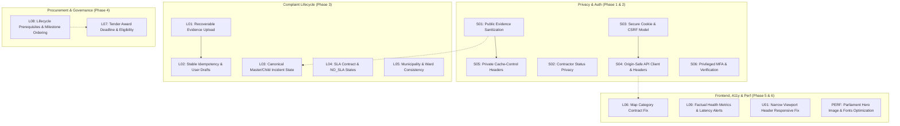

# CIVORA — SECURITY & RELIABILITY REMEDIATION REGISTER
**Document Reference**: CIVORA-AUDIT-2026-11-02  
**Baseline Date**: 2 November 2026  
**Auditor Scope**: Civora Production Web Application (`civora-tau.vercel.app`) & Backend REST API (`civora-l06w.onrender.com`)  
**Status**: Active Remediation Project

---

## 1. Executive Remediation Matrix

| Finding ID | Audit Priority | Audit Status | Current Source Status | Primary Affected Component(s) | Remediation Strategy | Verification Test Plan |
| :--- | :---: | :---: | :---: | :--- | :--- | :--- |
| **S01** | **P0** | Confirmed | **Present (Vulnerable)** | `complaints.controller.ts`, `evidence.controller.ts`, `transparency.controller.ts` | Strict DTO allowlist; strip `captureLatitude`, `captureLongitude`, `captureAccuracy`, hashes, timestamps from public DTOs; authorize exact metadata to owner/staff only; strip EXIF from public image previews | Integration tests asserting exact field allowlist on public `/track/:id`, `/transparency`, `/map`, and `/evidence` |
| **S02** | **P1** | Confirmed | **Present (Vulnerable)** | `auth.controller.ts` (`getContractorApplicationStatus`), `auth.routes.ts` | Require applicant authentication or cryptographically signed token; return minimal status (APPROVED / REJECTED / UNDER_REVIEW); strip PII & `reviewNotes`; generic 404 responses | Negative security tests verifying email-only lookup fails safely without disclosing PII or existence |
| **S03** | **P1** | Confirmed | **Present (Vulnerable)** | `client/src/main.tsx`, `AuthContext.tsx`, `auth.controller.ts` | Remove persistent bearer JWT from `localStorage`; rely on secure HttpOnly SameSite cookie sessions with CSRF protection, maintaining cross-device authorization resilience | Browser storage security tests; CSRF rejection on state-changing mutations |
| **S04** | **P1** | Confirmed | **Present (Vulnerable)** | `client/src/main.tsx`, `vercel.json`, `server/src/app.ts` | Replace broad global fetch `/api/` check with strict origin-matching client (`new URL(reqUrl, origin).origin === origin`); configure strict CSP, Referrer-Policy, Permissions-Policy headers in `vercel.json` and Express middleware | Header assertion tests; fetch origin isolation test ensuring external URLs never receive tokens |
| **S05** | **P1** | Confirmed | **Present (Vulnerable)** | `server/src/middleware/auth.middleware.ts`, `vercel.json`, `server/src/app.ts` | Explicit `Cache-Control: private, no-cache, no-store, must-revalidate` on all authenticated and sensitive API routes; ensure Vercel and proxies never cache user/staff responses | HTTP response header verification across all authenticated endpoints |
| **S06** | **P1** | Confirmed | **Present (Vulnerable)** | `server/src/controllers/auth.controller.ts`, `client/src/pages/LoginPage.tsx` | Distinguish registered vs contact-verified citizens; enforce MFA / TOTP verification for privileged `ADMIN` and `GOVERNMENT_OFFICIAL` accounts with secure recovery codes; prevent user enumeration | Privileged auth tests requiring MFA; verified citizen gating on trust-sensitive community actions |
| **L01** | **P1** | Confirmed | **Present (Vulnerable)** | `client/src/pages/ReportIssuePage.tsx`, `server/src/controllers/complaints.controller.ts` | Refactor filing flow into explicit state machine; validate `uploadRes.ok`; if upload fails, preserve draft & tracking reference, display partial/failure state with per-file retry without creating duplicate complaints | Failure injection tests: simulate 413, 500, network interruption; verify retry creates 0 duplicate complaints |
| **L02** | **P1** | Confirmed | **Present (Vulnerable)** | `client/src/pages/ReportIssuePage.tsx`, `server/src/controllers/complaints.controller.ts` | Generate one stable idempotency key per logical draft session; scope drafts in storage by authenticated user ID; clear draft on logout | Concurrency & retry test: verify timeout retry creates exactly 1 complaint; user B cannot read user A draft |
| **L03** | **P1** | Confirmed | **Present (Vulnerable)** | `transparency.controller.ts`, `complaints.controller.ts`, `TrackComplaintPage.tsx` | Unify canonical incident status and department across all endpoints; child reports reflect master's effective status & department; clearly distinguish report count from incident count | Consistency tests across list, tracker, map, and official queues for linked complaints |
| **L04** | **P1** | Confirmed | **Present (Vulnerable)** | `complaints.controller.ts`, `TrackComplaintPage.tsx`, `sla.controller.ts` | Align SLA field contracts between server and client; represent missing policy explicitly as `NO_SLA` with "No Configured SLA"; eliminate `Invalid Date` and unwarranted "On Track" badges | SLA contract tests: assert valid ISO strings; assert `NO_SLA` does not skew compliance metrics |
| **L05** | **P1** | Confirmed | **Present (Vulnerable)** | `server/src/config/wards.ts`, `client/src/config/wards.ts`, `complaint.validation.ts` | Explicitly document and declare supported municipality (Bengaluru BBMP); enforce canonical ward codes (`WARD-XXX`) with zone mapping; audit legacy demo records | Validation tests rejecting out-of-bounds locations; schema validation on ward formats |
| **L06** | **P2** | Confirmed | **Present (Vulnerable)** | `client/src/pages/CivicMapPage.tsx`, `server/src/controllers/meta.controller.ts` | Update `CivicMapPage.tsx` to consume normalized array `catJson.data` or `{ categories }`; ensure all 5 civic categories render in map dropdown and filter markers | Contract test validating category selector population and interactive map filtering |
| **L07** | **P1** | Confirmed | **Present (Vulnerable)** | `server/src/controllers/tenders.controller.ts` (`awardTender`) | Validate that `submissionDeadline` has passed before award; verify contractor is ACTIVE and has matching category capabilities; require audited exception for early awards; atomic transaction guards | Concurrency award test: assert award before deadline is rejected; ineligible bid cannot be awarded without override |
| **L08** | **P2** | Confirmed | **Present (Vulnerable)** | `OfficialWorkspacePage.tsx`, `ContractorWorkspacePage.tsx`, `contractor.controller.ts` | Hide/disable invalid actions (no "Submit Resolution" on `REJECTED` cases); enforce work-start verification (`VERIFIED`) and predecessor completion before claiming milestones | State transition tests asserting rejected cases cannot resolve; milestone 2 cannot precede milestone 1 |
| **L09** | **P2** | Confirmed | **Present (Vulnerable)** | `client/src/pages/AdminSystemPage.tsx`, `server/src/controllers/adminDashboard.controller.ts` | Replace misleading "active recently" with "registered accounts (non-suspended)"; label DB latency > 1000ms as "Degraded"; include contractors in demographic tallies; honest moderation state | Metrics calculation unit tests verifying exact arithmetic and threshold labeling |
| **U01** | **P1** | Confirmed | **Present (Vulnerable)** | `client/src/components/layout/Navbar.tsx` | Constrain navbar items on viewports <= 380px; allow brand area to shrink, collapse secondary controls into drawer, prevent flex blowout, ensure hamburger button remains accessible | Visual & viewport test across 320px, 360px, 390px, 768px, and 1280px without horizontal scroll |
| **PERF** | **P2** | Confirmed | **Present** | `client/public/parliament.png`, `client/index.html` | Optimize 1.54MB Parliament hero image with WebP/AVIF variants, explicit `width`/`height` attributes, and `aspect-ratio`; prune unused font weights | Image size reduction to < 250KB; Lighthouse LCP improvement |

---

## 2. Component Dependency Graph

---

## 3. Initial Baseline State

- **Application Verification Suite (`npm run test:verify`)**: 23/23 Passed (Baseline captured 2026-11-02 21:28)
- **AI Verification Suite (`npm run test:ai`)**: 24/24 Passed
- **Reliability Suite (`npm run test:reliability`)**: 6/6 Passed
- **Frontend Build (`npm run build --prefix client`)**: 0 TypeScript errors (Vite v8.3.4)
- **Backend Build (`npm run build --prefix server`)**: 0 TypeScript errors (Prisma v6.19.3)

