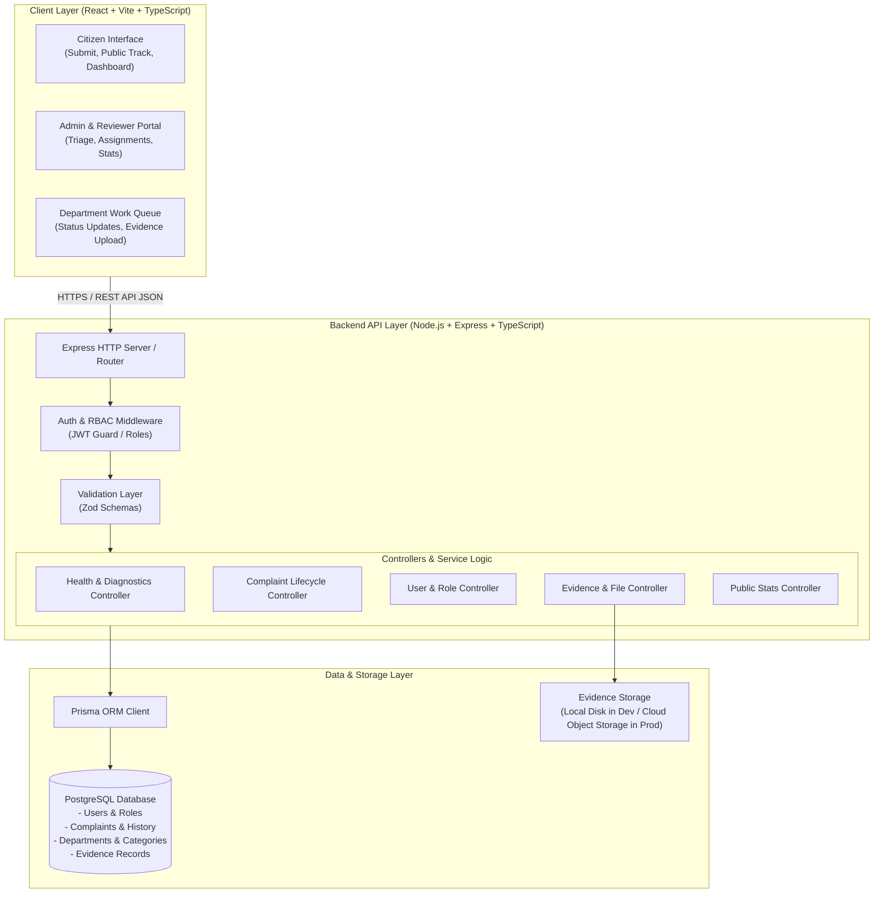

# Civora &mdash; High-Level System Architecture

This document describes the high-level system architecture of **Civora**, illustrating how the frontend client, backend API, relational database, and storage subsystems interact across the complaint lifecycle.

---

## 1. Conceptual Architecture Diagram

---

## 2. Core Architectural Components

### 2.1 Client Application (`client/`)
- **Technology:** React 19, TypeScript, Tailwind CSS v4, Vite.
- **Role:** Single Page Application (SPA) serving citizens, reviewers, and department officials.
- **Responsibilities:**
  - Client-side routing, accessible form rendering, and validation.
  - Asynchronous communication with the backend API.
  - Preserving citizen anonymity on public tracking views (PII masking).
  - Modern responsive design for mobile and desktop screens.

### 2.2 Backend Service (`server/`)
- **Technology:** Node.js, Express, TypeScript.
- **Role:** Centralized REST API server.
- **Responsibilities:**
  - Enforce business logic and complaint state transitions.
  - Role-based authorization (`CITIZEN`, `REVIEWER`, `OFFICIAL`, `ADMIN`).
  - Generate collision-resistant human-readable tracking IDs (e.g., `CIV-2026-XXXXX`).
  - Validate payloads and sanitize inputs to prevent injection attacks.
  - Serve diagnostic endpoints (`/api/health`).

### 2.3 Relational Database (`PostgreSQL`)
- **Technology:** PostgreSQL with Prisma ORM.
- **Role:** Single source of truth for persistent application state.
- **Planned Core Entities (Conceptual):**
  - **Users:** Credentials, roles, contact metadata.
  - **Departments:** Municipal bodies (e.g., Roads & Bridges, Sanitation, Electrical).
  - **Categories:** Issue classifications linked to default departments.
  - **Complaints:** Primary complaint records (title, description, location coordinates, address, status, tracking ID).
  - **ComplaintStatusHistory:** Immutable audit log recording every transition, timestamp, actor ID, and remarks.
  - **Evidence:** Photos and documents attached during submission or resolution.
  - **Feedback:** Citizen satisfaction ratings and comments upon resolution.

### 2.4 Evidence & Media Storage
- **Development:** Local structured file storage (`server/uploads/`) with strict MIME-type validation and file size limits.
- **Production (Future):** Cloud object storage (e.g., AWS S3 or GCP Cloud Storage) using pre-signed upload URLs to offload bandwidth.

---

## 3. Communication Patterns & Conventions

- **Data Exchange:** Pure JSON over HTTP REST.
- **Status Codes:** Standard HTTP semantics (`200 OK`, `201 Created`, `400 Bad Request`, `401 Unauthorized`, `403 Forbidden`, `404 Not Found`, `500 Internal Error`).
- **Development Proxy:** Vite dev server proxies `/api` requests to Express on `http://localhost:5000` to prevent CORS complications during local development.

---

> [!NOTE]
> Database schemas and specific API endpoints will be formalized in **Module 3 (Database Design)** and **Module 4 (Backend Foundation)** respectively.
