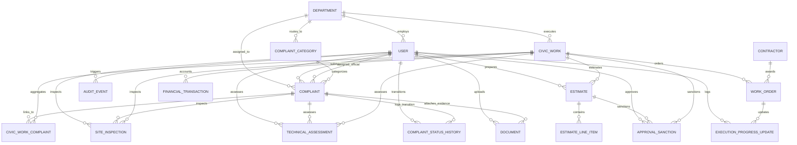

# Civora &mdash; Data Model & Database Architecture

## 1. Overview & Architectural Principles

The Civora database is designed to support the complete lifecycle of civic complaints &mdash; from citizen submission and reviewer triage to department assignment, on-site technical assessments, formal civic works (projects), DPRs/estimates, approvals, contractor execution, financial tracking, and verified resolution.

### Core Principles
1. **Separation of Concerns:** Simple complaints (e.g., a pothole or streetlight repair) can be resolved directly without creating a formal civic work. Complex issues requiring municipal capital expenditure can be linked to a formal `CivicWork` record.
2. **Strict Referential Integrity:** Foreign keys are explicitly defined on all relationships with intentional deletion semantics (`onDelete: Restrict` or `SetNull` to prevent accidental loss of civic audit records).
3. **Immutability of Audit Trails:** History tables (`ComplaintStatusHistory` and `AuditEvent`) are strictly append-only.
4. **Data Protection & Privacy:** Public tracking IDs (`trackingId`) are decoupled from internal database UUIDs. Sensitive citizen PII (phone, email, password hash) and internal administrative notes are kept private from public tracking queries.
5. **Accurate Financial Types:** All monetary amounts, unit rates, and budgets use precise `Decimal(14, 2)` types &mdash; avoiding floating-point inaccuracies.

---

## 2. Entity Relationship Diagram (ERD)

---

## 3. Core Data Categories & Entity Definitions

### Category A: Users & Access (`User`)
Stores citizen profiles, municipal reviewers, department officials, and system administrators.
- **`id`** (`UUID`, PK): Internal unique identifier.
- **`email`** (`VARCHAR(255)`, Unique): Login identifier.
- **`name`** (`VARCHAR(255)`): Full display name.
- **`phone`** (`VARCHAR(50)`, Optional): Contact number for SMS/notifications.
- **`passwordHash`** (`VARCHAR(255)`): Salted password hash (Argon2id/Bcrypt for Module 5).
- **`role`** (`ENUM: CITIZEN, GOVERNMENT_OFFICIAL, ADMIN`): Role-based access level.
- **`accountStatus`** (`ENUM: ACTIVE, PENDING_VERIFICATION, SUSPENDED`): Account state.
- **`departmentId`** (`UUID`, Optional, FK -> `Department`): Assigned department for municipal officials.
- **`emailVerifiedAt`** (`TIMESTAMP`, Optional): Verification timestamp.
- **`createdAt` / `updatedAt`**: Audit timestamps.
- **Privacy:** `email`, `phone`, and `passwordHash` are private and never exposed on public endpoints.

### Category B: Complaints (`Complaint`)
Primary entity capturing citizen civic issue reports and resolution progress.
- **`id`** (`UUID`, PK): Internal database key.
- **`trackingId`** (`VARCHAR(32)`, Unique, Indexed): Public alphanumeric reference (e.g., `CIV-2026-00142`).
- **`title`** (`VARCHAR(255)`): Concise issue summary.
- **`description`** (`TEXT`): Full citizen narrative.
- **`categoryId`** (`UUID`, FK -> `ComplaintCategory`): Issue domain classification.
- **`priority`** (`ENUM: LOW, MEDIUM, HIGH, URGENT`): Triage priority level.
- **`status`** (`ENUM: SUBMITTED, UNDER_REVIEW, ASSIGNED, IN_PROGRESS, RESOLVED, VERIFIED, REOPENED, REJECTED, CLOSED`): Current state machine status.
- **`citizenId`** (`UUID`, Optional, FK -> `User`): Submitting citizen (SetNull on user deletion to preserve civic record).
- **`assignedDepartmentId`** (`UUID`, Optional, FK -> `Department`): Responsible municipal authority.
- **`assignedOfficialId`** (`UUID`, Optional, FK -> `User`): Specific field engineer / official in charge.
- **`locationAddress`** (`TEXT`): Street/landmark details.
- **`locality`** (`VARCHAR(255)`): Neighborhood / locality name.
- **`ward`** (`VARCHAR(100)`, Optional): Administrative ward code or name.
- **`latitude` / `longitude`** (`DECIMAL(10, 7)`, Optional): Precision GPS coordinates for map overlays.
- **`rejectionReason`** (`TEXT`, Optional): Required if status is moved to `REJECTED`.
- **`resolutionNotes`** (`TEXT`, Optional): Official explanation when resolved.
- **`reviewedAt`, `assignedAt`, `resolvedAt`, `verifiedAt`, `closedAt`**: Lifecycle milestone timestamps.

### Category C: Projects & Civic Works (`CivicWork`)
Represents formal municipal infrastructure projects initiated when an issue exceeds routine maintenance.
- **`id`** (`UUID`, PK): Internal unique identifier.
- **`workOrderNumber`** (`VARCHAR(64)`, Unique): Official project reference code (e.g., `CW-2026-0042`).
- **`title`** (`VARCHAR(255)`): Formal project title.
- **`description`** (`TEXT`): Scope of municipal works.
- **`workType`** (`VARCHAR(100)`): Domain classification (e.g., Road Resurfacing, Drainage Overhaul).
- **`departmentId`** (`UUID`, FK -> `Department`): Managing department.
- **`location`** (`VARCHAR(255)`): Geographic location/ward.
- **`ward`** (`VARCHAR(100)`, Optional): Municipal ward reference.
- **`estimatedBudget`** (`DECIMAL(14, 2)`): Initial calculated cost.
- **`sanctionedAmount`** (`DECIMAL(14, 2)`, Optional): Officially sanctioned budget.
- **`plannedStartDate`, `plannedEndDate`**: Planned project window.
- **`actualStartDate`, `actualCompletionDate`**: Real field execution window.
- **`workStatus`** (`ENUM: PROPOSED, SANCTIONED, TENDERING, IN_PROGRESS, COMPLETED, CANCELLED`): Project execution state.

### Association: `CivicWorkComplaint` (M:N Link)
Allows a single comprehensive municipal work (e.g., resurfacing an entire street) to link and resolve multiple citizen complaints registered along that road.
- **`civicWorkId`** (`UUID`, FK -> `CivicWork`, Cascade).
- **`complaintId`** (`UUID`, FK -> `Complaint`, Restrict).
- **`linkedAt`** (`TIMESTAMP`): When complaint was attached to project.
- **`notes`** (`TEXT`, Optional): Linking rationale.

### Category D: Site Inspections (`SiteInspection`)
Logs physical field visits by municipal officials or engineers.
- **`id`** (`UUID`, PK).
- **`complaintId`** (`UUID`, Optional, FK -> `Complaint`).
- **`civicWorkId`** (`UUID`, Optional, FK -> `CivicWork`).
- **`inspectorId`** (`UUID`, FK -> `User`): Inspecting official.
- **`inspectionDate`** (`TIMESTAMP`): Date of visit.
- **`outcome`** (`ENUM: SATISFACTORY, NEEDS_REPAIR, WORK_REQUIRED, RESOLVED_ON_SITE, INVALID_COMPLAINT`).
- **`observations`** (`TEXT`): Field engineer notes.
- **`measurements`** (`TEXT`, Optional): Technical dimensions (e.g. pothole depth/area).

### Category E: Technical Assessments (`TechnicalAssessment`)
Engineering feasibility studies and repair recommendations.
- **`id`** (`UUID`, PK).
- **`complaintId`** (`UUID`, Optional, FK -> `Complaint`).
- **`civicWorkId`** (`UUID`, Optional, FK -> `CivicWork`).
- **`assessorId`** (`UUID`, FK -> `User`): Assessing engineer.
- **`assessmentDate`** (`TIMESTAMP`).
- **`technicalFindings`** (`TEXT`): Structural/root-cause analysis.
- **`requiredWork`** (`TEXT`): Recommended technical intervention.
- **`feasibility`** (`ENUM: FEASIBLE, CONDITIONALLY_FEASIBLE, NOT_FEASIBLE, REQUIRES_FURTHER_STUDY`).
- **`recommendation`** (`TEXT`): Formal engineering recommendation.

### Category F: Estimates & Detailed Project Reports (`Estimate` & `EstimateLineItem`)
Itemized bills of quantities and formal project estimates.
- **`Estimate`**:
  - **`id`** (`UUID`, PK).
  - **`estimateNumber`** (`VARCHAR(64)`, Unique): Official estimate code.
  - **`civicWorkId`** (`UUID`, FK -> `CivicWork`): Target project.
  - **`version`** (`INT`): Monotonically increasing revision counter (`1, 2, ...`).
  - **`preparedById`** (`UUID`, FK -> `User`): Authoring engineer.
  - **`description`** (`TEXT`): Scope of estimate.
  - **`status`** (`ENUM: DRAFT, SUBMITTED, REVISED, APPROVED, REJECTED`).
  - **`totalAmount`** (`DECIMAL(14, 2)`): Sum of all line items.
  - Unique constraint on `[civicWorkId, version]`.
- **`EstimateLineItem`**:
  - **`id`** (`UUID`, PK).
  - **`estimateId`** (`UUID`, FK -> `Estimate`, Cascade).
  - **`itemNumber`** (`INT`): Sequence index within estimate.
  - **`description`** (`VARCHAR(500)`): Standard specification of work item.
  - **`quantity`** (`DECIMAL(10, 2)`): Measured quantity.
  - **`unitOfMeasurement`** (`VARCHAR(50)`): E.g., `sq.m`, `cu.m`, `meters`, `tonnes`.
  - **`unitRate`** (`DECIMAL(12, 2)`): Unit cost per standard Schedule of Rates.
  - **`totalAmount`** (`DECIMAL(14, 2)`): Calculated product (`quantity * unitRate`).
  - Unique constraint on `[estimateId, itemNumber]`.

### Category G: Approvals & Sanctions (`ApprovalSanction`)
Multi-stage sanction records for administrative, technical, and financial clearances.
- **`id`** (`UUID`, PK).
- **`referenceNumber`** (`VARCHAR(64)`, Unique, Optional): Government order / sanction number.
- **`civicWorkId`** (`UUID`, FK -> `CivicWork`).
- **`estimateId`** (`UUID`, Optional, FK -> `Estimate`).
- **`approvalType`** (`ENUM: TECHNICAL_SANCTION, ADMINISTRATIVE_APPROVAL, FINANCIAL_SANCTION, WORK_ORDER_APPROVAL`).
- **`approverId`** (`UUID`, FK -> `User`): Sanctioning authority.
- **`decision`** (`ENUM: PENDING, APPROVED, REJECTED, MODIFICATIONS_REQUESTED`).
- **`decisionDate`** (`TIMESTAMP`, Optional).
- **`sanctionedAmount`** (`DECIMAL(14, 2)`, Optional): Approved expenditure ceiling.
- **`remarks`** (`TEXT`, Optional).

### Category H: Contractors & Execution (`Contractor`, `WorkOrder`, `ExecutionProgressUpdate`)
Manages contractor allocations, work orders, and physical execution updates.
- **`Contractor`**:
  - **`id`** (`UUID`, PK).
  - **`name`** (`VARCHAR(255)`): Firm or contractor name.
  - **`registrationNumber`** (`VARCHAR(100)`, Unique, Optional): License/registration ID.
  - **`contactPerson`, `email`, `phone`** (`VARCHAR`).
  - **`status`** (`ENUM: ACTIVE, INACTIVE, BLACKLISTED`).
- **`WorkOrder`**:
  - **`id`** (`UUID`, PK).
  - **`workOrderNumber`** (`VARCHAR(64)`, Unique): Issued contract order ID.
  - **`civicWorkId`** (`UUID`, FK -> `CivicWork`).
  - **`contractorId`** (`UUID`, FK -> `Contractor`).
  - **`workOrderDate`** (`TIMESTAMP`).
  - **`contractAmount`** (`DECIMAL(14, 2)`).
  - **`startDate`, `expectedCompletionDate`, `actualCompletionDate`**.
  - **`executionStatus`** (`ENUM: AWARDED, COMMENCED, IN_PROGRESS, SUBSTANTIALLY_COMPLETED, COMPLETED, TERMINATED`).
- **`ExecutionProgressUpdate`**:
  - **`id`** (`UUID`, PK).
  - **`workOrderId`** (`UUID`, FK -> `WorkOrder`).
  - **`loggedById`** (`UUID`, FK -> `User`): Supervising official.
  - **`updateDate`** (`TIMESTAMP`).
  - **`physicalProgressPercentage`** (`DECIMAL(5, 2)`): Progress (`0.00%` &ndash; `100.00%`).
  - **`financialProgressAmount`** (`DECIMAL(14, 2)`, Optional): Value of completed work.
  - **`progressNotes`** (`TEXT`).
  - **`milestoneReached`** (`VARCHAR(255)`, Optional).

### Category I: Financial Records (`FinancialTransaction`)
Double-entry compatible audit records of municipal expenditure and contractor disbursements.
- **`id`** (`UUID`, PK).
- **`civicWorkId`** (`UUID`, FK -> `CivicWork`).
- **`recordType`** (`ENUM: BUDGET_ALLOCATION, CONTRACTOR_PAYMENT, EXPENSE_REIMBURSEMENT, RETENTION_HOLD, PENALTY_DEDUCTION`).
- **`amount`** (`DECIMAL(14, 2)`): Transaction value.
- **`paymentDate`** (`TIMESTAMP`, Optional).
- **`paymentReference`** (`VARCHAR(100)`, Optional): Treasury voucher / banking reference.
- **`paymentStatus`** (`ENUM: PLANNED, PROCESSING, PAID, HELD, FAILED`).
- **`remarks`** (`TEXT`, Optional).

### Category J: Documents & Media Metadata (`Document`)
Structured metadata for photographic proof, reports, and sanction orders with explicit foreign keys.
- **`id`** (`UUID`, PK).
- **`fileName`** (`VARCHAR(255)`): Original uploaded file name.
- **`storageKey`** (`VARCHAR(500)`): Cloud/local path reference.
- **`mimeType`** (`VARCHAR(100)`): E.g., `image/jpeg`, `application/pdf`.
- **`fileSize`** (`BIGINT`): Size in bytes.
- **`documentCategory`** (`ENUM: COMPLAINT_EVIDENCE, INSPECTION_PHOTO, ASSESSMENT_REPORT, DPR_DOCUMENT, APPROVAL_LETTER, WORK_ORDER_COPY, PROGRESS_PHOTO, INVOICE_RECEIPT, COMPLETION_CERTIFICATE`).
- **`uploaderId`** (`UUID`, Optional, FK -> `User`).
- **`visibility`** (`ENUM: PUBLIC, INTERNAL_OFFICIAL, RESTRICTED_ADMIN`): Visibility boundary.
- **`description`** (`TEXT`, Optional).
- **Explicit Parent Relations:**
  - `complaintId` (`UUID`, Optional, FK -> `Complaint`).
  - `siteInspectionId` (`UUID`, Optional, FK -> `SiteInspection`).
  - `technicalAssessmentId` (`UUID`, Optional, FK -> `TechnicalAssessment`).
  - `estimateId` (`UUID`, Optional, FK -> `Estimate`).
  - `approvalSanctionId` (`UUID`, Optional, FK -> `ApprovalSanction`).
  - `progressUpdateId` (`UUID`, Optional, FK -> `ExecutionProgressUpdate`).
  - `financialTransactionId` (`UUID`, Optional, FK -> `FinancialTransaction`).

### Category K: Workflow & Audit History
1. **`ComplaintStatusHistory`** (Complaint-specific lifecycle audit):
   - **`id`** (`UUID`, PK).
   - **`complaintId`** (`UUID`, FK -> `Complaint`, Cascade).
   - **`fromStatus`** (`ENUM: ComplaintStatus`, Optional).
   - **`toStatus`** (`ENUM: ComplaintStatus`).
   - **`changedById`** (`UUID`, Optional, FK -> `User`).
   - **`reasonOrRemarks`** (`TEXT`, Optional).
   - **`createdAt`** (`TIMESTAMP`).
2. **`AuditEvent`** (System-wide append-only security log):
   - **`id`** (`UUID`, PK).
   - **`entityType`** (`VARCHAR(50)`): E.g., `COMPLAINT`, `CIVIC_WORK`, `ESTIMATE`, `APPROVAL`, `FINANCIAL_TRANSACTION`, `USER`.
   - **`entityId`** (`UUID`): ID of altered record.
   - **`action`** (`VARCHAR(50)`): E.g., `CREATE`, `UPDATE`, `STATUS_CHANGE`, `ASSIGN`, `VERIFY`, `REOPEN`, `DELETE`.
   - **`actorId`** (`UUID`, Optional, FK -> `User`).
   - **`details`** (`JSONB`, Optional): Before/after diff snapshot.
   - **`ipAddress` / `userAgent`** (`VARCHAR`, Optional).
   - **`createdAt`** (`TIMESTAMP`).

### Supporting Reference Entities
- **`Department`**: `code` (Unique), `name`, `description`, `isActive`.
- **`ComplaintCategory`**: `code` (Unique), `name`, `description`, `departmentId` (Default department), `isActive`.

---

## 4. Privacy & Access Classifications

| Data Domain | Public Access | Official / Reviewer Access | Administrator Access |
| :--- | :--- | :--- | :--- |
| **Citizen Complaints** | Tracking ID, Title, Category, Locality, Ward, Status, Public Evidence, Resolution Notes | Full complaint, Unmasked citizen details, Field notes, Inspection logs | Full control, Department assignments, Reassignment history |
| **Citizen Profile** | **Masked** (`J*** D***, +91 98***`) | Contact number for verification / dispatch | Full profile, Account status management |
| **Civic Works & DPRs** | Project title, Budget, Status, Planned dates, Execution progress % | Itemized estimates, Inspection measurements, Contractor details | Full financial allocations, Sanction approvals |
| **Financial Records** | High-level expenditure aggregate | Line-item payment statuses, Contract amounts | Full audit trail, Bank vouchers, Treasury allocations |
| **Audit Logs** | Not visible | Read-only access to relevant complaint histories | Full system audit trail inspection |

---

## 5. Deletion & Retention Rules

- **Complaints & History:** Hard deletion of complaints is strictly restricted. Soft deletion or status `CLOSED` is used to preserve municipal records for RTI and public auditing.
- **Financial & Sanctions:** `onDelete: Restrict` is enforced on all financial transactions, approvals, and work orders to guarantee tamper-proof accountability.
- **Cascade Boundaries:** Only subordinate child components (`EstimateLineItem` of an `Estimate`, or `ComplaintStatusHistory` of a `Complaint`) cascade delete when their direct parent is intentionally removed in development/draft state.
