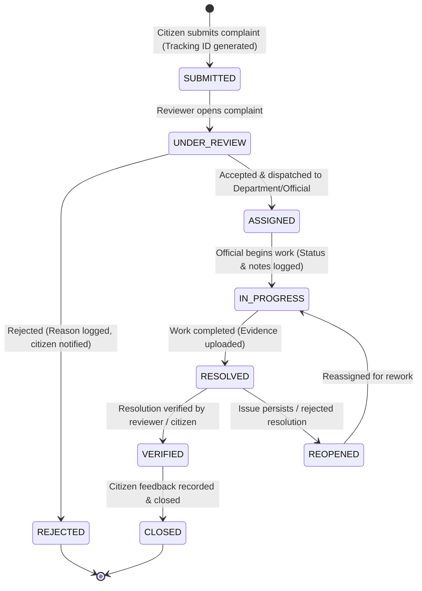

# Civora &mdash; Development Roadmap & Plan

## 1. Project Goal & Overview

**Civora** is a civic issue reporting and public accountability web application designed to bridge the gap between citizens, municipal authorities, and public transparency.

The platform enables citizens to report local civic issues (such as road damage, uncollected waste, broken streetlights, water drainage problems), obtain a unique tracking ID, and follow the complaint through its complete resolution lifecycle with verifiable evidence.

### Primary User Roles

1. **Citizen**
   - Submits civic complaints with title, description, category, location, and photos.
   - Receives unique tracking IDs.
   - Tracks resolution progress and status history publicly or via personal dashboard.
   - Submits feedback once a resolution is marked.

2. **Administrator / Reviewer**
   - Triages incoming reports (verifies validity, prevents spam/abuse).
   - Accepts or rejects complaints with clear, documented reasons.
   - Assigns accepted complaints to the appropriate municipal department or field official.
   - Monitors overall system resolution SLAs and departmental workload.

3. **Department Official**
   - Views their department's active queue of assigned civic issues.
   - Updates progress states and uploads progress/resolution evidence (notes, photos).
   - Marks complaints as resolved upon field completion.

4. **Public Viewer**
   - Tracks issues by ID with citizen PII masked.
   - Explores public transparency dashboards, resolution statistics, and municipal metrics.

---

## 2. Intended Complaint Lifecycle

---

## 3. Planned Module Sequence

Development proceeds strictly in sequential, dependency-ordered modules:

1. **Module 1: Project Planning & Repository Setup** &mdash; *(Completed)*
   - Directory structure, initial TypeScript configs, Vite + Tailwind frontend skeleton, Express backend skeleton with `/api/health`, and documentation.
2. **Module 2: Frontend Foundation & Shared UI Components** &mdash; *(Completed)*
   - Cohesive civic design tokens (`tokens.css`), responsive layout shell (`AppShell`, `Navbar` with mobile toggle, `Footer`, `Container`), reusable UI library (`Button`, `Card`, `FormField`, `TextInput`, `TextArea`, `Select`, `Badge`, `Alert`, `LoadingIndicator`, `EmptyState`, `PageHeading`, accessible SVG icons), lightweight history router, and public placeholder pages (`LandingPage`, `ReportIssuePage`, `TrackComplaintPage`, `NotFoundPage`).
3. **Module 3: Database Design & Migrations** &mdash; *(Completed)*
   - PostgreSQL schema modeling with Prisma covering all 11 core categories + supporting tables (`User`, `Complaint`, `CivicWork`, `CivicWorkComplaint`, `SiteInspection`, `TechnicalAssessment`, `Estimate`, `EstimateLineItem`, `ApprovalSanction`, `Contractor`, `WorkOrder`, `ExecutionProgressUpdate`, `FinancialTransaction`, `Document`, `ComplaintStatusHistory`, `AuditEvent`, `Department`, `ComplaintCategory`), precise decimal financial types, initial migration SQL generated (`20261016000000_init_civora_schema`), Prisma Client generated, and data model documentation in `docs/data-model.md`.
4. **Module 4: Backend Foundation, API Structure, Database Integration & Dummy Test Data** &mdash; *(Completed)*
   - Resolved initial migration shadow-database `P3006` error (UTF-8 BOM stripped), verified clean migration application to PostgreSQL database `Cevora`.
   - Express application architecture with factory (`createApp`), CORS, JSON parser, graceful shutdown (`SIGINT`/`SIGTERM`), and centralized error/404 handlers.
   - Comprehensive `/api/health` endpoint with active database ping and query latency metrics.
   - Extensible modular route structure (`routes/`, `controllers/`, `middleware/`, `lib/`) with `/api/meta` endpoints.
   - Idempotent, reproducible seed script (`prisma/seed.ts`) populating all 11 core categories and relational master tables with realistic fictional test data.
   - Integration and unit test suite with 9 passing tests using Node's native test runner (`tsx --test`).
   - Comprehensive backend guide in `server/docs/backend-setup.md`.
5. **Module 5: Authentication, Authorization, Role-Based Access Control & User Identity** &mdash; *(Completed)*
   - Bcrypt password hashing and verification with 10 salt rounds and password strength validation (min 8 chars, max 128 chars).
   - Dual-delivery JWT session strategy via `HttpOnly` secure cookies and `Authorization: Bearer` headers with 7-day expiration.
   - Public citizen registration (`POST /api/auth/register`) with server-side `CITIZEN` enforcement, preventing privilege escalation.
   - Secure login (`POST /api/auth/login`) with generic error messages preventing email enumeration, and account status validation (`SUSPENDED` / `PENDING_VERIFICATION`).
   - Reusable auth middleware (`authenticateUser`) and RBAC authorization guard (`requireRoles`) protecting private routes and `/api/auth/admin-check`.
   - Comprehensive test accounts (`citizen1`, `official1`, `admin1`, `suspended1`, `pending1`) with reproducible seed script.
   - Frontend authentication integration with `AuthContext`, `useAuth`, `LoginPage`, `RegisterPage`, and user state controls in `Navbar`.
   - 30 passing automated tests covering registration, login, token handling, impersonation prevention, and RBAC.
   - Complete documentation in `server/docs/authentication.md`.
6. **Module 6: Complaint Reporting, Tracking IDs & Lifecycle Management** &mdash; *(Completed)*
   - Citizen grievance reporting form with location metadata, category mapping, and Crockford-style collision-resistant tracking IDs (`CIV-YYYY-XXXXX`).
   - Privacy-safe public complaint tracking without exposing citizen PII.
   - Strict status transition state machine, audit logging, and administrative triage queue.
7. **Module 7: Department Assignment, Official Progress Tracking, Evidence Management & Resolution Verification** &mdash; *(Completed)*
   - Department assignment & reassignment preservation with transactional audit history.
   - Official progress updates with milestone stages, public vs internal memo filtering, and auto-advancement to `IN_PROGRESS`.
   - On-site inspections with measurements, inspector attribution, and structured outcomes.
   - Evidence metadata registration with path traversal prevention, MIME allowlists, and 10MB limits.
   - Official resolution submission transitioning complaints to `RESOLVED`.
   - Citizen resolution verification transitioning complaints to `VERIFIED` or requesting reopening (`REOPENED`) with mandatory reasons.
   - Dedicated Government Official Workspace (`OfficialWorkspacePage`) and comprehensive automated test suite (70 tests passing).
8. **Module 8: Public Transparency Dashboard, Civic Project Monitoring & Accountability Analytics** &mdash; *(Completed)*
   - Public transparency metrics (`/api/transparency/metrics`), trends (`/api/transparency/trends`), and status distribution (`/api/transparency/status-distribution`).
   - Public grievance explorer (`/api/transparency/complaints`) with search, filter, pagination, and zero citizen PII exposure.
   - Department accountability scorecards (`/api/transparency/departments`) with workload share, backlog, resolution rate, and fair comparison context.
   - Formal civic project monitoring (`/api/projects`, `/api/projects/:id`) querying `CivicWork`, `WorkOrder`, and `ExecutionProgressUpdate`, strictly maintaining complaints and projects as distinct entities.
   - Frontend transparency suite (`TransparencyPage.tsx`) with pure SVG charts (`TrendAreaChart`, `DonutChart`, `HorizontalBarChart`), responsive filters, project inspection modal, and navbar navigation.
   - 83 automated backend tests passing cleanly with zero failures. Complete documentation in `server/docs/public-transparency.md`.
9. **Module 9: Notification System, Real-Time Alerts, Citizen–Official Communication & Notification Preferences** &mdash; *(Completed)*
   - Database schema additions (`Notification`, `NotificationPreference`, `ComplaintMessage`) deployed safely via Prisma migration `20261017161028_add_notifications_and_messages` without data loss.
   - Centralized backend notification service with deduplication engine, notification preferences filtering, and domain event triggers across complaint submission, status changes, assignments, official progress updates, resolution verification, and complaint reopening.
   - Focused complaint-linked communication thread with server-side RBAC (citizen owner, assigned official/department, admin) preventing cross-complaint leaks and hiding internal staff notes from public/citizens.
   - Full notification center UI (`NotificationsPage.tsx`) with read/unread filtering, pagination, mark-as-read, and deep links.
   - Interactive navbar bell with unread count badge, quick-preview popover dropdown (`NotificationDropdown.tsx`), and automated 25s polling with window focus trigger.
   - Notification preferences page (`NotificationPreferencesPage.tsx`) with immediate persist feedback and granular event toggles.
   - Complaint message thread component (`ComplaintMessageThread.tsx`) integrated directly into citizen tracking (`TrackComplaintPage.tsx`) and official workspace (`OfficialWorkspacePage.tsx`).
   - 97 automated tests across 29 test suites passing with zero failures. Complete documentation in `server/docs/notifications.md`.
10. **Module 10: Civic Engagement, Community Proposals, Public Polls & Community Feedback** &mdash; *(Completed)*
   - Community proposal submission form with collision-resistant tracking IDs (`PROP-YYYY-XXXXX`), structured problem/solution fields, and civic category mapping.
   - Comprehensive moderation workflow for municipal staff (`ADMIN`, `GOVERNMENT_OFFICIAL`) with status lifecycle transitions (`SUBMITTED`, `UNDER_REVIEW`, `NEEDS_CLARIFICATION`, `PUBLISHED`, `ACCEPTED_FOR_CONSIDERATION`, `DECLINED`, `ARCHIVED`).
   - Strict segregation between confidential internal staff notes and public moderator feedback.
   - Official municipal authority responses announcing feasibility studies without falsely implying project sanction.
   - Public civic polls and advisory surveys with single-choice and multi-choice constraints, time-bounded voting windows (`startDate`, `endDate`), and configurable results visibility (`ALWAYS_VISIBLE`, `AFTER_VOTE`, `AFTER_CLOSE`).
   - Concurrency-safe voting integrity backed by a database-level unique constraint on `(pollId, userId)` in `poll_participations`, preventing duplicate votes under concurrent requests.
   - 1-click citizen proposal endorsement support (1 vote/toggle per citizen) and moderated public comment threads.
   - Module 9 notification integration automatically alerting submitters and voters upon proposal events and recorded votes.
   - Civic Engagement Hub (`EngagementHubPage.tsx`), Proposal Submission form (`ProposalSubmitPage.tsx`), Proposal Detail view (`ProposalDetailPage.tsx`), and Poll Participation view (`PollDetailPage.tsx`).
   - 118 automated tests passing across 35 suites with 21 dedicated Module 10 tests. Complete documentation in `server/docs/engagement.md`.
11. **Module 11: Service-Level Agreements (SLAs), Escalation Management, Overdue Case Resolution & Department Accountability** &mdash; *(Completed)*
   - 5-tier deterministic SLA policy engine, response/resolution deadlines, multi-level escalation workflow, supervisor extension reviews, and transparency scorecards.
12. **Module 12: Document & Evidence Management, Secure File Uploads, Evidence Verification & Resolution Proof** &mdash; *(Completed)*
   - Cryptographic SHA-256 verification, magic-byte inspection, multi-purpose evidence registration, review queue, resolution proof decoupling, and quarantine safeguards.
13. **Module 13: Civic Search, Interactive Maps, Geographic Insights & Location-Based Complaint Discovery** &mdash; *(Completed)*
   - Great-circle Haversine engine, coordinate privacy generalization (~110m resolution), bounding box and proximity queries, ward/locality hotspot clustering, offline Bengaluru geodirectory, interactive Leaflet CivicMap, and accessible list view toggle.
14. **Module 14: Fraud Prevention, Spam Protection, Content Moderation & Abuse Reporting** &mdash; *(Completed)*
   - Layered rate limiters, explainable risk scoring, advisory duplicate complaint detection, citizen abuse reporting, staff moderation queue, time-bounded user restrictions, and transparent appeals with separation of duties.
15. **Module 15: Accessibility, Multilingual Support & Inclusive Citizen Experience** &mdash; *(Completed)*
   - Type-safe React 19 internationalization supporting English, Hindi (Devanagari), and Punjabi (Gurmukhi); 4-tier preference hierarchy; WCAG 2.2 Level AA compliance (keyboard focus rings, skip-to-main link, aria-live region, non-color status icons, scalable text 100%-130%, reduced motion, high contrast); low-connectivity auto-draft persistence; and database-backed accessibility preference storage.
16. **Module 16: System Administration, Platform Configuration, Audit Reporting & Operational Health** &mdash; *(Completed)*
   - Centralized multi-tabbed administration console (`AdminSystemPage.tsx`), dynamic configuration management (General, Maintenance, Workflow, Security) with transactional change logs, backend-enforced maintenance mode (HTTP 503 on writes with admin bypass), public liveness/readiness probes (`/api/health`, `/api/health/ready`), protected admin diagnostics (`/api/health/diagnostics`), correlation IDs (`X-Request-Id`), user & role administration with self-modification and last-admin safeguards, operational incident tracking (`INC-YYYY-XXXXX`), and CWE-1236 formula-injection-defended CSV exports.

---

## 4. Proposed Technology Stack

| Layer | Technology | Rationale |
| :--- | :--- | :--- |
| **Frontend** | React 19 + Vite + TypeScript | High performance, strict type safety, fast developer feedback loop. |
| **Styling** | Tailwind CSS v4 | Utility-first, responsive, lightweight, cohesive design tokens. |
| **Backend** | Node.js + Express + TypeScript | Robust, mature asynchronous REST architecture with shared types. |
| **Database** | PostgreSQL | Relational integrity, ACID compliance, robust geospatial & JSON support. |
| **ORM & Migrations**| Prisma | Type-safe queries, declarative schema migrations, automated client generation. |
| **Version Control** | Git & GitHub | Modular branching, atomic commits per module. |

---

## 5. Definition of Done &mdash; Modules Status

### Module 1: Initial Setup
- [x] Workspace inspected and verified isolated under `Civora/.git`.
- [x] Client initialized with Vite, React, TypeScript, and Tailwind CSS.
- [x] Client renders initial Civora foundation view with active API status check.
- [x] Server initialized with Express, TypeScript, CORS, and `/api/health` endpoint.
- [x] Client builds successfully with zero TypeScript or Vite errors (`tsc -b && vite build`).
- [x] Server builds successfully with zero TypeScript errors (`tsc`).
- [x] Root configuration in place: `.gitignore`, `.env.example`, `package.json`, `README.md`.
- [x] Initial architecture and roadmap documentation created in `docs/`.

### Module 2: Frontend Foundation & Shared UI Components
- [x] Reusable civic design tokens established in `tokens.css` (dark canvas, slate surfaces, civic blue, teal accents, high-contrast text).
- [x] Reusable UI component library created (`Button`, `Card`, `FormField`, `TextInput`, `TextArea`, `Select`, `Badge`, `Alert`, `LoadingIndicator`, `EmptyState`, `PageHeading`, accessible SVG icons).
- [x] Responsive layout shell built (`AppShell`, accessible `Navbar` with mobile drawer toggle, `Footer` with mission and disclaimer, `Container`).
- [x] Accessible browser history client router implemented (`Router`, `NavLink`, `useRouter`) without external dependency bloat.
- [x] Landing page created with value proposition, 4-step lifecycle breakdown, category previews, accountability commitment, and live health check probe.
- [x] Report Issue placeholder page created with full form preview, upload dropzone preview, guidelines sidebar, and clear preview-only notice.
- [x] Track Complaint placeholder page created with tracking ID search input, timeline progression demo, and PII masking preview.
- [x] Not-found page (404) created with accessible empty state and navigation back to overview.
- [x] Full production build passes cleanly (`npm run build`).
- [x] Linter (`oxlint`) passes with 0 warnings and 0 errors.

### Module 3: Database Design & Migrations
- [x] Data model fully designed and documented in `docs/data-model.md` with ERD and entity breakdowns.
- [x] Schema covers all 11 required core data categories (Users, Complaints, Projects/Works, Inspections, Technical Assessments, Estimates/DPRs, Approvals/Sanctions, Contractors/Execution, Financial Records, Documents/Media, and Audit/Status History).
- [x] Supporting tables implemented: `Department` and `ComplaintCategory`.
- [x] Distinction maintained between standalone complaints and formal civic works (`CivicWorkComplaint` M:N relation).
- [x] Monetary amounts and rates use exact precision types (`Decimal(14, 2)`).
- [x] Explicit foreign keys, unique constraints, and search indexes defined.
- [x] Deletion rules configured: `Restrict` on core history/financial entities, `Cascade` on child line items, `SetNull` on optional user references.
- [x] Schema validated with Prisma (`npx prisma validate` passes with zero errors).
- [x] Prisma Client generated successfully (`npx prisma generate`).
- [x] Server and client builds pass with 0 errors.

### Module 4: Backend Foundation, API Structure & Database Integration
- [x] Fixed migration P3006 shadow-database failure safely and applied `20261016000000_init_civora_schema` cleanly to `Cevora` database (19 tables, 16 enums, 58 indexes).
- [x] Express application foundation with CORS, JSON parsing, cookie parsing, health check, and metadata routes (`/api/health`, `/api/meta/departments`, `/api/meta/categories`, `/api/meta/stats`).
- [x] Comprehensive, repeatable development seed data (`server/prisma/seed.ts`) with master departments, civic categories, fictional users (citizens, officials, admin), and realistic complaints.
- [x] Integration test suite validating database connection and metadata endpoints.

### Module 5: Authentication, Authorization & User Identity
- [x] Secure authentication with bcrypt password hashing (cost factor 10), email normalization, and zero password exposure.
- [x] JWT sessions with dual transport: HttpOnly `civora_auth_token` cookies with CSRF SameSite protection, plus `Authorization: Bearer` fallback.
- [x] Current-user profile endpoint (`GET /api/auth/me`) extracting identity solely from verified server sessions.
- [x] Role-Based Access Control (`requireRoles`) distinguishing `CITIZEN`, `GOVERNMENT_OFFICIAL`, and `ADMIN`.
- [x] Brute-force rate limiting with `express-rate-limit`.
- [x] 30 automated integration tests covering authentication, registration, session isolation, and RBAC.

### Module 6: Citizen Complaint Reporting, Tracking IDs & Complaint Management
- [x] Collision-resistant server-side tracking ID generation (`CIV-YYYY-XXXXX`) using Crockford-safe alphanumeric alphabet with uniqueness constraint.
- [x] Strict state machine enforcing complaint lifecycle transitions (`SUBMITTED` → `UNDER_REVIEW` → `ASSIGNED` → `IN_PROGRESS` → `RESOLVED` → `VERIFIED` → `CLOSED`), rejecting illegal transitions and requiring reasons for rejections.
- [x] Append-only audit history logging every status transition atomically in `complaint_status_history`.
- [x] Citizen endpoints: `POST /api/complaints`, `GET /api/complaints/my` (with status filtering and pagination), `GET /api/complaints/:id` (with ownership enforcement).
- [x] Public-safe tracking endpoint (`GET /api/complaints/track/:trackingId`) returning complaint timeline and details while strictly redacting citizen PII.
- [x] Administrative review endpoints (`GET /api/admin/complaints`, `PATCH /api/admin/complaints/:id/status`, `PATCH /api/admin/complaints/:id/assign`) restricted to `ADMIN` and `GOVERNMENT_OFFICIAL`.
- [x] Frontend pages: `ReportIssuePage.tsx` with dynamic category loading and prominent tracking ID success modal; `TrackComplaintPage.tsx` with live audit timeline; `MyComplaintsPage.tsx` citizen dashboard; `AdminComplaintsPage.tsx` triage queue.
- [x] 48 automated tests in `server/test/` passing cleanly with 100% success rate.
- [x] Comprehensive documentation in `server/docs/complaint-management.md`.

### Module 7: Department Assignment, Official Progress Tracking, Evidence Management & Resolution Verification
- [x] Department assignment & reassignment preservation with transactional audit history and zero duplicate counting.
- [x] Official progress updates with milestone stages, public vs internal memo filtering, and auto-advancement to `IN_PROGRESS`.
- [x] On-site inspections with measurements, inspector attribution, and structured outcomes.
- [x] Evidence metadata registration with path traversal prevention, MIME allowlists, and 10MB limits.
- [x] Official resolution submission transitioning complaints to `RESOLVED`.
- [x] Citizen resolution verification transitioning complaints to `VERIFIED` or requesting reopening (`REOPENED`) with mandatory reasons.
- [x] Dedicated Government Official Workspace (`OfficialWorkspacePage`) for department field staff.
- [x] 70 automated backend tests passing cleanly with zero failures. Complete documentation in `server/docs/complaint-management.md`.

### Module 8: Public Transparency Dashboard, Civic Project Monitoring & Accountability Analytics
- [x] Public transparency metrics (`/api/transparency/metrics`) dynamically aggregating complaints, resolution rates, and average/median turnaround times.
- [x] Trend analysis (`/api/transparency/trends`) tracking intake vs. resolution trends across configurable day horizons (7, 30, 90, 180, 365 days).
- [x] Status distribution endpoint (`/api/transparency/status-distribution`) providing canonical status breakdowns and percentage shares.
- [x] Department accountability analytics (`/api/transparency/departments`) detailing workload share %, active backlogs, and resolution rates without double-counting reassigned complaints.
- [x] Public grievances explorer (`/api/transparency/complaints`) with keyword search, category/department/status filters, pagination, and strict server-side PII redactions.
- [x] Formal civic project monitoring (`/api/projects`, `/api/projects/:id`) querying `CivicWork`, `WorkOrder`, and `ExecutionProgressUpdate`, strictly maintaining complaints and projects as distinct entities.
- [x] Frontend transparency suite (`TransparencyPage.tsx`) featuring 4 tabs (Overview Analytics, Grievances Explorer, Department Scorecards, Civic Works Projects), responsive pure SVG charts (`TrendAreaChart`, `DonutChart`, `HorizontalBarChart`), and project inspection modal.
- [x] 83 automated backend tests passing cleanly with zero failures. Complete documentation in `server/docs/public-transparency.md`.

### Module 9: Notification System, Real-Time Alerts, Citizen–Official Communication & Notification Preferences
- [x] Prisma schema extended with `Notification`, `NotificationPreference`, and `ComplaintMessage` models and `NotificationType` enum.
- [x] Safe non-destructive migration `20261017161028_add_notifications_and_messages` validated and deployed cleanly to `Cevora` database.
- [x] Centralized backend notification service (`notificationService.ts`) with user preference filtering, 5-minute event deduplication window, and unread count queries.
- [x] Backend domain triggers connected across complaint submission, status changes, assignments, official progress updates, resolution verification, and complaint reopening.
- [x] Complaint-linked communication API (`/api/complaints/:id/messages`) enforcing strict RBAC (citizen owner, assigned official/department, admin) with safe plain-text rendering and internal staff note flags.
- [x] Notification REST endpoints (`/api/notifications`, `/api/notifications/unread-count`, `/api/notifications/:id/read`, `/api/notifications/read-all`, `/api/notifications/preferences`).
- [x] Interactive frontend notification bell in navbar with live unread badge, popover dropdown (`NotificationDropdown.tsx`), and automated 25-second polling with window focus trigger.
- [x] Full notification center page (`NotificationsPage.tsx`) supporting status filters (`all`, `unread`, `read`), pagination, mark-as-read, and deep links.
- [x] Granular notification preferences page (`NotificationPreferencesPage.tsx`) with instant visual feedback and channel toggles.
- [x] Complaint communication thread component (`ComplaintMessageThread.tsx`) embedded within `TrackComplaintPage.tsx` and `OfficialWorkspacePage.tsx`.
- [x] 97 automated tests across 29 test suites passing with zero failures. Complete documentation in `server/docs/notifications.md`.

### Module 10: Civic Engagement, Community Proposals, Public Polls & Community Feedback
- [x] Database schema extended with `ProposalStatus`, `PollStatus`, `PollType`, `PollVisibilityRule` enums, plus `CommunityProposal`, `ProposalSupport`, `ProposalComment`, `PublicPoll`, `PollOption`, `PollVote`, and `PollParticipation` models.
- [x] Non-destructive Prisma migration `20261018013703_add_civic_engagement_and_polls` validated and applied cleanly to `Cevora` database.
- [x] Collision-resistant proposal tracking ID generator (`generateUniqueProposalTrackingId` &rarr; `PROP-YYYY-XXXXX`).
- [x] Citizen community proposal submission (`POST /api/engagement/proposals`) with category mapping, locality, and problem/solution fields.
- [x] Server-side validation enforcing title, description, and category rules using Zod.
- [x] Public proposal listing (`GET /api/engagement/proposals`) strictly filtering for `PUBLISHED` and `ACCEPTED_FOR_CONSIDERATION` statuses; unpublished proposals return 404 to non-owner citizens.
- [x] Staff moderation queue (`GET /api/engagement/admin/proposals`) and status transition handler (`PATCH /api/engagement/admin/proposals/:id/status`) strictly separating confidential internal staff memos from public explanations.
- [x] Authoritative official responses (`POST /api/engagement/admin/proposals/:id/response`) recorded with official attribution and timestamps.
- [x] Public polls engine supporting single-choice and multi-choice polls with selection limits and time-bounded voting windows (`startDate`, `endDate`).
- [x] Concurrency-safe voting integrity with double-barrier protection and database-level `UNIQUE(pollId, userId)` constraint mapping duplicate submissions to HTTP 409 Conflict.
- [x] Results visibility policy enforcement (`ALWAYS_VISIBLE`, `AFTER_VOTE`, `AFTER_CLOSE`) preventing premature exposure of aggregate vote counts.
- [x] Community endorsement toggling (1 vote per citizen per proposal) and public comments thread.
- [x] Module 9 notification system integration dispatching real-time notifications for proposal lodging, moderation status updates, official responses, and recorded votes.
- [x] Frontend views: Civic Engagement Hub (`EngagementHubPage.tsx`), Proposal Submission form (`ProposalSubmitPage.tsx`), Proposal Detail view (`ProposalDetailPage.tsx`), and Poll Participation view (`PollDetailPage.tsx`).
- [x] Fully integrated into navbar navigation for both desktop and mobile layouts.
- [x] 118 automated tests passing across 35 suites (21 dedicated Module 10 tests) with zero failures. Complete documentation in `server/docs/engagement.md`.

### Module 11: Service-Level Agreements (SLAs), Escalation Management, Overdue Case Resolution & Department Accountability
- [x] Database schema extended with `SlaStatus`, `EscalationLevel`, `EscalationStatus`, `EscalationTrigger`, and `ExtensionRequestStatus` enums.
- [x] New models deployed: `SlaPolicy`, `ComplaintSla`, `ComplaintEscalation`, `EscalationActionLog`, and `SlaExtensionRequest`. Extended `NotificationType` with 5 SLA alert events.
- [x] Non-destructive Prisma migration `20261018032946_add_sla_and_escalation_system` validated and deployed cleanly to `Cevora` database.
- [x] Deterministic 5-tier policy selection engine (`SlaEngine.selectPolicyForComplaint`) covering exact category+priority, category-specific, priority-specific, platform default fallback, and explicit NO_SLA classification.
- [x] Automated initial response and resolution deadline calculation upon complaint lodging, preserving immutable original vs. current deadlines in UTC.
- [x] SLA status strictly decoupled from complaint lifecycle status (`ON_TRACK`, `APPROACHING_DEADLINE`, `OVERDUE_RESPONSE`, `OVERDUE_RESOLUTION`, `RESOLVED_WITHIN_SLA`, `RESOLVED_OVERDUE`).
- [x] Idempotent evaluation engine (`SlaEngine.evaluateAllActiveComplaints`) preventing duplicate notifications and duplicate escalation tickets across repeated scheduler runs.
- [x] Multi-level escalation workflow (`LEVEL_1_OFFICIAL`, `LEVEL_2_SUPERVISOR`, `LEVEL_3_HEAD_ADMIN`) with chronological audit history (`EscalationActionLog`), supervisor manual triggers, acknowledgment, and corrective action planning.
- [x] Controlled deadline extension workflow enforcing Separation of Duties: requesting officials are strictly prohibited from approving their own extensions.
- [x] Citizen-facing tracking integration (`TrackComplaintPage.tsx`) rendering SLA commitment cards, response targets, resolution targets, and public escalation notices while strictly redacting confidential internal staff notes.
- [x] Comprehensive Staff & Administrator workspace (`SlaManagementPage.tsx`) featuring 4 tabs: Overdue & Escalation Queue, SLA Policy Administration, Extension Review Queue, and Department Accountability Scorecards.
- [x] Official workspace badge integration (`OfficialWorkspacePage.tsx`) highlighting approaching/breached deadlines for field staff.
- [x] Departmental accountability scorecard analytics (`GET /api/sla/metrics`) and privacy-safe public transparency metrics (`GET /api/sla/transparency`).
- [x] Notification integration dispatching alerts for approaching deadlines, overdue breaches, escalations, extension submissions, and extension decisions.
- [x] Realistic, non-destructive demo seed data (`CIV-2026-OVERDUE-01` with SLA snapshot, Level 2 escalation, action logs, and pending extension request).
- [x] 142 automated tests passing across 43 test suites (24 dedicated Module 11 tests) with zero failures. Complete documentation in `server/docs/sla-and-escalation.md`.

### Module 12: Document & Evidence Management, Secure File Uploads, Evidence Verification & Resolution Proof
- [x] Database schema extended with `EvidencePurpose` (`CITIZEN_SUPPORTING`, `OFFICIAL_PROGRESS`, `RESOLUTION_PROOF`, `ADMINISTRATIVE`) and `EvidenceReviewStatus` (`PENDING_REVIEW`, `UNDER_REVIEW`, `VERIFIED`, `REJECTED`, `RESUBMISSION_REQUESTED`, `QUARANTINED`) enums.
- [x] Extended `Document` model with metadata fields (`sha256Checksum`, `reviewStatus`, `rejectionReason`, `resubmissionGuidance`, `replacedDocumentId`, `isQuarantined`, `quarantineReason`, `reviewedById`, `reviewedAt`) and immutable review history (`EvidenceReviewLog`).
- [x] Non-destructive Prisma migration `20261018052000_add_evidence_and_document_management` validated and deployed cleanly to `Cevora` database.
- [x] Secure storage abstraction (`StorageService`) with magic-byte verification (JPEG, PNG, WebP, PDF), SHA-256 cryptographic hashing, path traversal prevention, and private disk storage outside web roots.
- [x] Multer memory storage middleware (`uploadEvidenceFiles`) supporting single/multiple file uploads (up to 5 files, 10MB individual limit, 50MB batch limit).
- [x] Strict role and scope authorization: citizens can only upload citizen supporting evidence to their own complaints; officials are restricted to assigned department cases; administrative files are restricted.
- [x] Resolution proof upload strictly decoupled from complaint status (uploading proof does NOT automatically resolve or verify a complaint).
- [x] Dedicated evidence verification workflow (`POST /api/evidence/:id/review`) supporting approval, rejection with mandatory `rejectionReason`, and resubmission requests with mandatory `resubmissionGuidance`.
- [x] Administrator quarantine engine (`POST /api/evidence/:id/quarantine`) locking abusive/malicious content from public and citizen downloads.
- [x] Secure access-controlled streaming endpoints (`/api/evidence/:id/file` and `/api/evidence/:id/download`) with `nosniff`, private caching, and dynamic content disposition.
- [x] Notification integration dispatching alerts across 7 new events (`EVIDENCE_UPLOADED`, `EVIDENCE_VERIFIED`, `EVIDENCE_REJECTED`, `EVIDENCE_RESUBMISSION_REQUESTED`, `EVIDENCE_QUARANTINED`, `RESOLUTION_PROOF_SUBMITTED`, `RESOLUTION_PROOF_VERIFIED`).
- [x] Reusable frontend component suite (`EvidenceSection.tsx` and `EvidenceReviewQueue.tsx`) integrated into Citizen tracking (`TrackComplaintPage.tsx`), Official workspace (`OfficialWorkspacePage.tsx`), Administrator complaints dashboard (`AdminComplaintsPage.tsx`), and Issue reporting (`ReportIssuePage.tsx`).
- [x] 164 automated backend tests passing across 44 test suites (20 dedicated Module 12 tests) with zero failures. Complete documentation in `server/docs/evidence-management.md`.

### Module 13: Civic Search, Interactive Maps, Geographic Insights & Location-Based Discovery
- [x] Database schema extended with `locationSource` (`GPS_DEVICE`, `MAP_PICKER`, `MANUAL_ENTRY`, `GEOCODED`), `locationAccuracy`, and `isLocationPublic` privacy flag on `Complaint` model.
- [x] Added database indexes on `[locality]`, `[ward]`, `[latitude, longitude]`, and `[isLocationPublic]`.
- [x] Non-destructive Prisma migration `20261018213000_add_location_metadata_and_geo_indexes` validated and deployed cleanly to `Cevora` database.
- [x] Great-circle Haversine distance engine and coordinate generalization (~110m privacy resolution with deterministic micro-jitter) implemented in `GeoService`.
- [x] Safe bounding-box viewport queries (`GET /api/geo/complaints`) with span-size validation preventing DoS from oversized queries (> 5 degrees span).
- [x] Radius-based nearby complaint discovery (`GET /api/geo/nearby`) returning closest public issues sorted ascending by proximity.
- [x] Geographic hotspots & clustering analytics (`GET /api/geo/hotspots`) aggregating complaints by municipal ward or locality with active vs. resolved breakdowns and overdue rates.
- [x] Built-in offline directory of Bengaluru municipal zones, BBMP wards, and landmarks (`GET /api/geo/localities` and `/api/geo/geocode`).
- [x] Official department-scoped geographic dashboard (`GET /api/geo/official-summary`) enforcing strict department boundaries for field staff.
- [x] Complaint location refinement API (`PATCH /api/geo/complaints/:id/location`) with ownership checks and immutable audit trail logging.
- [x] Interactive Leaflet map component (`CivicMap.tsx`) with custom status pins, direct case inspection popups, and privacy guarantee badges.
- [x] Interactive click-to-pin location modal (`LocationPickerModal.tsx`) integrated into complaint lodging (`ReportIssuePage.tsx`).
- [x] Full-featured Civic Map Explorer (`CivicMapPage.tsx`) supporting search, status/category/locality filters, "Near Me" radius queries, and accessible list view toggle.
- [x] 184 automated backend tests passing cleanly across 45 test suites (20 dedicated Module 13 tests) with zero failures. Complete documentation in `server/docs/civic-search-and-maps.md`.

### Module 14: Fraud Prevention, Spam Protection, Content Moderation & Abuse Reporting
- [x] Database schema extended with `AbuseReportReason`, `AbuseReportStatus`, `ReportTargetType`, `ModerationCaseStatus`, `ModerationPriority`, `ModerationActionType`, `AppealStatus`, and `UserRestrictionType` enums.
- [x] Models deployed: `AbuseReport`, `ModerationCase`, `ModerationAction`, `ModerationAppeal`, `UserRestriction`, and `ComplaintDuplicateLink`. Extended `NotificationType` with 5 moderation notification events and added `isModerated`/`moderationReason` target flags.
- [x] Non-destructive Prisma migration `20261018223000_add_moderation_and_fraud_prevention` validated and deployed cleanly to `Cevora` database.
- [x] Layered rate limiting engine (`rateLimiters.ts`) enforcing endpoint-specific limits (auth, complaint lodging, comments, proposals, poll voting, abuse reporting, geographic search) with standard retry indicators and trusted-proxy handling.
- [x] Advisory, non-destructive duplicate complaint detector (`duplicateDetector.ts`) computing multi-factor similarity (category match, ward/locality match, Haversine proximity $\le 300\text{m}$, tokenized Jaccard description overlap) with privacy-safe citizen warnings and official linking.
- [x] Citizen-facing abuse reporting API (`POST /api/moderation/reports`) with target validation, report deduplication, automated case aggregation, and reporter PII shielding.
- [x] Staff moderation triage engine (`riskScoring.ts`) calculating explainable $0-100$ priority scores based on documented platform signals without automated penalties or political classification.
- [x] Consequential moderation actions requiring mandatory $\ge 5$-character documented reasons, reversible content hiding/removal, and immutable audit trails.
- [x] Time-bounded, auto-expiring user restriction service (`restrictionService.ts`) and action guards (`requireNoRestriction`).
- [x] Transparent appeals workflow (`POST /api/moderation/cases/:id/appeal` and `POST /api/moderation/appeals/:id/review`) with strict separation of duties: the reviewing official cannot be the moderator who imposed the penalty.
- [x] Module 9 notification integration dispatching alerts for warnings, content moderation, account restrictions, restriction lifts, and appeal decisions.
- [x] Reusable frontend components and views: `ReportAbuseModal.tsx`, Public Platform Rules (`PlatformRulesPage.tsx` at `/rules`), Staff Moderation Workspace (`ModerationQueuePage.tsx` at `/admin/moderation`), and debounced duplicate advisory banner in `ReportIssuePage.tsx`.
- [x] 206 automated backend tests passing cleanly across 54 test suites (22 dedicated Module 14 tests) with zero failures. Complete documentation in `server/docs/fraud-prevention-and-moderation.md`.

### Module 15: Accessibility, Multilingual Support & Inclusive Citizen Experience
- [x] Database schema extended with `UserAccessibilityPreference` model with relation to `User` (`userId` unique, cascade delete, fields: `language`, `textSize`, `reducedMotion`, `highContrast`).
- [x] Non-destructive Prisma migration `20261019000000_add_user_accessibility_preferences` validated and deployed cleanly to PostgreSQL database `Cevora`.
- [x] REST API endpoints (`GET /api/accessibility/languages`, `GET /api/accessibility/preferences`, `PUT /api/accessibility/preferences`) with Zod schema validation, guest defaults fallback, and immutable `AuditEvent` logging.
- [x] Lightweight, type-safe React 19 internationalization architecture (`client/src/i18n/`) supporting English (`en`), Hindi (`hi` in Devanagari script), and Punjabi (`pa` in Gurmukhi script) across 14 namespaces with zero external package bloat.
- [x] Reliable fallback mechanism to canonical English dictionary when a translation key is missing or undefined.
- [x] Multi-tier preference resolution hierarchy: (1) Authenticated account preference, (2) LocalStorage (`civora_language`), (3) Browser navigator language, (4) English default.
- [x] Locale synchronization with HTML document: `document.documentElement.lang` and `dir="ltr"` automatically updated on language change.
- [x] Locale-aware formatting utilities (`formatLocaleDate`, `formatLocaleNumber`) respecting active locale conventions without altering machine-readable ISO timestamps or database values.
- [x] Keyboard-accessible `LanguageSelector` dropdown component with ARIA listbox semantics, focus indication, and Escape key dismissal.
- [x] Modal accessibility settings dialog (`AccessibilitySettingsModal`) with focus trap, text scaling controls ($100\%, 115\%, 130\%$), reduced motion toggle, and high contrast mode.
- [x] WCAG 2.2 Level AA accessibility baseline across UI components:
  - Skip-to-main-content link (`#main-content`) implemented in `AppShell.tsx`.
  - Screen reader `LiveAnnouncer` with `aria-live` regions (`polite` and `assertive`).
  - Visible focus rings (`focus-visible:ring-2 focus-visible:ring-blue-500`) across all interactive controls.
  - Status indicators enhanced in `Badge.tsx` with distinct SVG icons alongside text labels to eliminate color-alone reliance (WCAG 2.2 SC 1.4.1).
  - Form buttons updated with `aria-busy` and minimum touch target heights ($\ge 36-44\text{px}$).
- [x] Script-appropriate typography in `index.css`: native font fallbacks for Devanagari and Gurmukhi (`Nirmala UI`, `Gurmukhi MN`, `Raavi`, `Mukta`) with generous line-height ($1.55$) preventing diacritic clipping.
- [x] Low-bandwidth and network-resilience support:
  - Debounced auto-save of non-sensitive complaint form input to `localStorage` (`civora_complaint_draft`).
  - Restored draft notice with 1-click "Discard Draft" action.
  - Non-destructive network error handling: citizen input is preserved upon failure without clearing fields.
  - Truthful connectivity messaging: explicitly informs users when internet connection is required rather than falsely promising offline queuing.
- [x] Preserved complaint integrity: citizen-submitted complaint descriptions, tracking IDs, and backend status enums remain unchanged and uncorrupted.
- [x] 217 automated backend tests passing cleanly across 59 test suites (11 dedicated Module 15 tests) with zero failures. Complete documentation in `server/docs/accessibility-and-i18n.md`.

### Module 16: System Administration, Platform Configuration, Audit Reporting & Operational Health
- [x] Database schema extended with `PlatformSetting`, `ConfigurationChangeLog`, and `OperationalIncident` models, with complete reverse relations on `User`.
- [x] Non-destructive Prisma migration `20261019120000_add_system_admin_and_operational_models` deployed cleanly to PostgreSQL database `Cevora`.
- [x] Platform configuration service (`configService.ts`) with in-memory caching (15s TTL), transactional change history, and immutability guarantees for deployment secrets (.env).
- [x] Correlation ID middleware (`X-Request-Id`) attached to all incoming requests, errors, and responses.
- [x] Backend-enforced maintenance mode (`maintenanceMode.middleware.ts`) returning HTTP 503 for non-admin write requests while preserving read access, authentication login, admin recovery routes, and health probes.
- [x] Public liveness probe (`/api/health`), deployment readiness probe (`/api/health/ready`), and protected administrator diagnostics (`/api/health/diagnostics`).
- [x] User and role administration endpoints (`/api/admin/users`) with operational safeguards preventing self-modification, self-suspension, and accidental demotion or suspension of the last remaining platform administrator.
- [x] Operational incident lifecycle (`INC-YYYY-XXXXX`) supporting `OPEN`, `INVESTIGATING`, `MONITORING`, and `RESOLVED` states with mandatory resolution notes.
- [x] Bounded, server-side filtered audit explorer (`/api/admin/audit`) with sensitive token and credential redaction.
- [x] Administrative CSV exports for Audit Logs, Complaint Workflows, and Operational Incidents fortified with CWE-1236 Formula Injection defense (apostrophe prefixing for `=`, `+`, `-`, `@`).
- [x] Multi-tabbed frontend administration suite in `client/src/pages/AdminSystemPage.tsx` with live telemetry, modals, responsive tables, and WCAG 2.2 AA accessibility.
- [x] Full internationalization support with `adminSystem` keys across `en.ts`, `hi.ts`, and `pa.ts`.
- [x] 241 automated backend tests passing cleanly across 68 test suites (24 dedicated Module 16 tests) with zero failures. Complete documentation in `server/docs/system-administration.md`.

---

> [!NOTE]
> **Implementation Note:** All features of Modules 1 through 16 are fully implemented, verified, and tested end-to-end.

